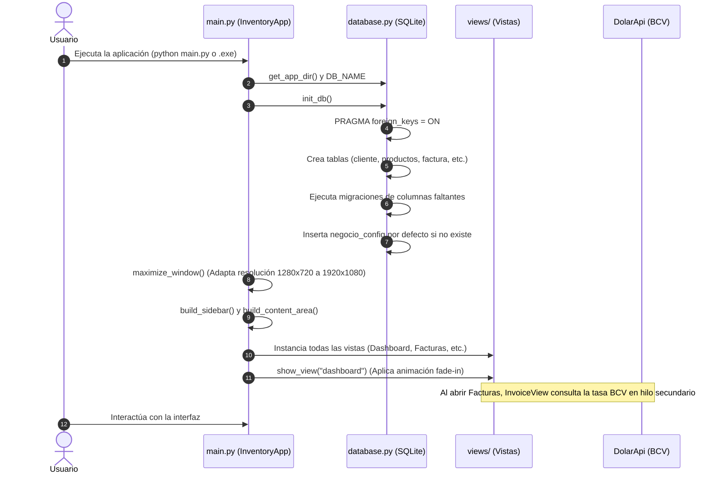
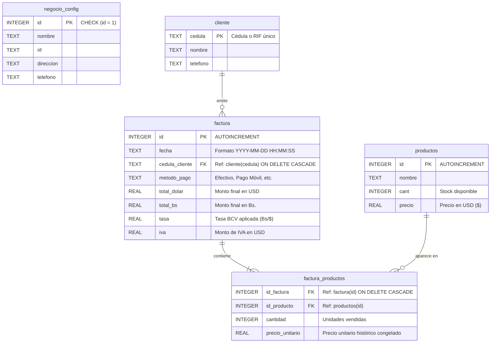

# 📖 Manual Técnico y Documentación de Arquitectura

**Sistema de Inventario, Facturación y Punto de Venta para Windows**  
Este documento complementa el `README.md` principal, ofreciendo un desglose técnico profundo sobre el diseño del sistema, la arquitectura modular, las tecnologías involucradas, la guía paso a paso para la inicialización y el modelo relacional de la base de datos.

---

## 📑 Tabla de Contenidos
1. [Descripción General del Sistema](#1-descripción-general-del-sistema)
2. [Arquitectura y Estructura del Software](#2-arquitectura-y-estructura-del-software)
3. [Stack Tecnológico y Librerías Utilizadas](#3-stack-tecnológico-y-librerías-utilizadas)
4. [Flujo de Inicialización y Ciclo de Vida](#4-flujo-de-inicialización-y-ciclo-de-vida)
5. [Guía de Puesta en Marcha (Inicio Paso a Paso)](#5-guía-de-puesta-en-marcha-inicio-paso-a-paso)
6. [Estructura y Modelo de la Base de Datos (SQLite)](#6-estructura-y-modelo-de-la-base-de-datos-sqlite)
7. [Transacciones Críticas y Reglas de Negocio](#7-transacciones-críticas-y-reglas-de-negocio)
8. [Sistema de Exportación y Reportes](#8-sistema-de-exportación-y-reportes)
9. [Empaquetado y Distribución (.exe)](#9-empaquetado-y-distribución-exe)

---

## 1. Descripción General del Sistema

El **Sistema de Inventario y Facturación** es una aplicación de escritorio nativa (*Desktop GUI*) desarrollada íntegramente en **Python**, diseñada para entornos comerciales que requieren:
- Control de existencias e inventario en tiempo real con alertas de stock crítico.
- Emisión ágil de facturas de venta con cálculo automático bimonetario (Dólares estadounidenses **USD** y Bolívares venezolanos **Bs.**).
- Detección y actualización en vivo de la tasa oficial del Banco Central de Venezuela (BCV).
- Respaldo transaccional local sin necesidad de servidores externos ni conexión permanente a internet.
- Exportación automatizada de auditorías y libros contables a hojas de cálculo Microsoft Excel (`.xlsx`).

---

## 2. Arquitectura y Estructura del Software

La aplicación sigue un enfoque de **Separación de Responsabilidades** inspirado en una arquitectura por capas (*Layered Architecture / MVC adaptado a GUI*):

```
┌─────────────────────────────────────────────────────────────┐
│                    CAPA DE PRESENTACIÓN                     │
│  main.py (Ventana Principal, Enrutador, Barra Lateral)      │
│  views/ (Dashboard, Facturas, Inventario, Clientes, etc.)   │
│  animations.py (Transiciones y Spinners Asíncronos)         │
└──────────────────────────────┬──────────────────────────────┘
                               │
                               ▼
┌─────────────────────────────────────────────────────────────┐
│                      CAPA DE SERVICIOS                      │
│  excel_exporter.py (Generación jerárquica de reportes)      │
│  DolarApi / BCV API (Consumo HTTP de tipo de cambio oficial)│
└──────────────────────────────┬──────────────────────────────┘
                               │
                               ▼
┌─────────────────────────────────────────────────────────────┐
│               CAPA DE PERSISTENCIA Y DATOS                  │
│  database.py (Conexiones, Migraciones, Consultas SQL, ACID) │
│  inventory_system.db (Motor relacional SQLite embebido)     │
└─────────────────────────────────────────────────────────────┘
```

### 📁 Mapa de Módulos del Proyecto

```text
Sistema de inventario/
│
├── main.py                     # Punto de entrada principal (Entrypoint).
│                               # Define InventoryApp, ciclo de vida de la ventana,
│                               # menú lateral, barra de estado y cambio de temas.
│
├── database.py                 # Capa de datos relacional (SQLite3).
│                               # Contiene esquemas, migraciones, CRUD de productos,
│                               # clientes, facturación atómica y métricas de analítica.
│
├── excel_exporter.py           # Motor de generación de reportes OpenPyXL.
│                               # Gestiona la creación de libros 'YYYY-MM.xlsx',
│                               # hojas diarias ('Día DD') y formatos condicionales.
│
├── animations.py               # Motor de micro-interacciones visuales.
│                               # Incluye LoadingSpinner asíncrono y efecto fade-in.
│
├── build_exe.py                # Pipeline de compilación a binario nativo Windows
│                               # utilizando PyInstaller con empaquetado portable.
│
├── views/                      # Sub-módulos de vistas especializadas:
│   ├── dashboard_view.py       # Pantalla de inicio minimalista y saludo de bienvenida.
│   ├── invoice_view.py         # Punto de venta, selector de productos, tasa BCV en hilo secundario.
│   ├── inventory_view.py       # Catálogo de productos, buscador, alertas de stock <= 5 y CRUD.
│   ├── history_view.py         # Historial de ventas con buscador y visor modal de partidas.
│   ├── client_view.py          # Directorio de clientes con cédula/RIF y teléfono.
│   ├── statistics_view.py      # Analítica visual con gráficos Matplotlib embebidos.
│   └── settings_modal.py       # Ventana modal para edición de datos fiscales del negocio.
│
├── reportes/                   # Directorio de destino para los reportes Excel generados.
├── dist/                       # Destino del binario final SistemaInventario.exe.
└── inventory_system.db         # Archivo de base de datos relacional local SQLite.
```

---

## 3. Stack Tecnológico y Librerías Utilizadas

El sistema combina la biblioteca estándar de Python con dependencias especializadas para garantizar alto rendimiento, bajo consumo de memoria y estética visual de nivel comercial:

| Librería / Módulo | Tipo | Versión Recomendada | Propósito en el Sistema |
| :--- | :--- | :--- | :--- |
| **Python** | Lenguaje Base | 3.8 a 3.12+ | Entorno de ejecución e interpretación. |
| **`customtkinter`** | Dependencia Externa | `>= 5.2.0` | Framework de GUI moderno que extiende `tkinter` con soporte nativo de temas oscuro/claro, esquemas de color personalizables, bordes redondeados y escalado automático según DPI. |
| **`tkinter`** | Biblioteca Estándar | Incluida con Python | Núcleo de eventos de ventana, widgets base y lienzo (`Canvas`) para animaciones y modales flotantes (`CTkToplevel`). |
| **`sqlite3`** | Biblioteca Estándar | Incluida con Python | Motor de base de datos relacional serverless, autocontenido, de cero configuración y compatible con transacciones ACID. |
| **`openpyxl`** | Dependencia Externa | `>= 3.1.0` | Generación, manipulación y estilización de hojas de cálculo de Microsoft Excel (.xlsx), aplicando paletas de color institucionales, bordes dobles contables y anchos dinámicos. |
| **`matplotlib`** | Dependencia Externa | `>= 3.7.0` | Renderizado de gráficos analíticos (barras horizontales y líneas cronológicas) embebidos en la interfaz mediante el backend `FigureCanvasTkAgg`. |
| **`pillow` (PIL)** | Dependencia Externa | `>= 9.5.0` | Procesamiento, carga y renderizado de imágenes de interfaz y logotipos. |
| **`urllib.request` / `json`** | Biblioteca Estándar | Incluida con Python | Cliente HTTP ligero para consultar la API de tasa cambiaria oficial sin necesidad de dependencias pesadas como `requests`. |
| **`threading`** | Biblioteca Estándar | Incluida con Python | Ejecución de tareas asíncronas en segundo plano (como la consulta de la tasa BCV) para evitar congelar el hilo principal de la interfaz (*UI Thread*). |
| **`pyinstaller`** | Herramienta de Construcción | `>= 6.0.0` | Empaquetador para compilar el código fuente y el intérprete en un único ejecutable autónomo para Windows (`.exe`). |

---

## 4. Flujo de Inicialización y Ciclo de Vida

El proceso de arranque de la aplicación sigue una secuencia coordinada y segura:



### Detección Inteligente de Rutas (`sys.frozen`)
Tanto `database.py` como `excel_exporter.py` implementan la función `get_app_dir()`:
```python
if getattr(sys, 'frozen', False):
    return os.path.dirname(sys.executable)
return os.path.dirname(os.path.abspath(__file__))
```
**Importancia técnica:** Cuando la aplicación corre como ejecutable compilado con PyInstaller, el archivo temporal desempaquetado no debe ser donde se guarde la base de datos ni los reportes. Esta lógica garantiza que `inventory_system.db` y la carpeta `reportes/` permanezcan **siempre en la misma carpeta física del archivo `.exe`**, evitando pérdida involuntaria de información.

---

## 5. Guía de Puesta en Marcha (Inicio Paso a Paso)

### Prerrequisitos
- Sistema Operativo Windows 7, 8, 10 u 11.
- Python 3.8 o superior instalado y agregado a la variable de entorno `PATH`.

### Paso 1: Clonar o Descargar el Proyecto
Ubique la carpeta del proyecto en su sistema:
```bash
cd "c:\Users\jagar\OneDrive\Documents\Sistema de inventario"
```

### Paso 2: Crear un Entorno Virtual (Recomendado)
Para mantener las dependencias aisladas del sistema global:
```powershell
python -m venv venv
.\venv\Scripts\activate
```

### Paso 3: Instalar las Dependencias
Ejecute la instalación de los paquetes requeridos:
```powershell
pip install customtkinter pillow matplotlib openpyxl pyinstaller
```

### Paso 4: Iniciar la Aplicación en Modo Desarrollo
Para arrancar el sistema con consola de depuración activa:
```powershell
python main.py
```

### Paso 5: Generar el Ejecutable Nativo (.exe)
Para generar el archivo portable listo para distribución comercial:
```powershell
python build_exe.py
```
El ejecutable autónomo se creará en la carpeta `dist/SistemaInventario.exe`.

---

## 6. Estructura y Modelo de la Base de Datos (SQLite)

La base de datos utiliza el motor relacional embebido **SQLite3** con soporte estricto de integridad referencial.

### Diagrama Entidad - Relación (MER)



---

### Detalle de Tablas y Esquemas DDL

#### 1. Tabla: `cliente`
Almacena el padrón de compradores.
```sql
CREATE TABLE IF NOT EXISTS cliente (
    cedula   TEXT PRIMARY KEY,
    nombre   TEXT NOT NULL,
    telefono TEXT
);
```
- **`cedula`** *(TEXT, PK)*: Número de cédula de identidad o RIF (ej. `V-12345678`, `J-12345678-0`). Normalizado mediante `UPPER(TRIM(?))`.
- **`nombre`** *(TEXT, NOT NULL)*: Razón social o nombre completo del cliente.
- **`telefono`** *(TEXT)*: Teléfono móvil o fijo de contacto.

---

#### 2. Tabla: `productos`
Almacena el catálogo de artículos y el inventario disponible.
```sql
CREATE TABLE IF NOT EXISTS productos (
    id     INTEGER PRIMARY KEY AUTOINCREMENT,
    nombre TEXT NOT NULL,
    cant   INTEGER NOT NULL DEFAULT 0,
    precio REAL NOT NULL DEFAULT 0.0
);
```
- **`id`** *(INTEGER, PK, AUTOINCREMENT)*: Identificador numérico único de producto.
- **`nombre`** *(TEXT, NOT NULL)*: Descripción comercial del producto.
- **`cant`** *(INTEGER, NOT NULL)*: Existencias disponibles en stock. Disminuye de forma automática tras cada facturación.
- **`precio`** *(REAL, NOT NULL)*: Precio de venta unitario expresado en dólares estadounidenses ($).

---

#### 3. Tabla: `factura`
Registra el encabezado y datos fiscales de cada venta concretada.
```sql
CREATE TABLE IF NOT EXISTS factura (
    id             INTEGER PRIMARY KEY AUTOINCREMENT,
    fecha          TEXT NOT NULL,
    cedula_cliente TEXT NOT NULL,
    metodo_pago    TEXT NOT NULL,
    total_dolar    REAL NOT NULL DEFAULT 0.0,
    total_bs       REAL NOT NULL DEFAULT 0.0,
    tasa           REAL NOT NULL DEFAULT 0.0,
    iva            REAL NOT NULL DEFAULT 0.0,
    FOREIGN KEY (cedula_cliente) REFERENCES cliente (cedula) ON DELETE CASCADE
);
```
- **`id`** *(INTEGER, PK, AUTOINCREMENT)*: Número secuencial de la factura (mostrado como `FAC-0001`).
- **`fecha`** *(TEXT, NOT NULL)*: Marca de tiempo en formato ISO estándar (`YYYY-MM-DD HH:MM:SS`).
- **`cedula_cliente`** *(TEXT, FK)*: Relación directa hacia la tabla `cliente`. Si el cliente es eliminado, se borran sus facturas en cascada.
- **`metodo_pago`** *(TEXT, NOT NULL)*: Mecanismo de pago empleado (`Efectivo ($)`, `Pago Móvil`, `Transferencia`, `Punto de Venta / Tarjeta`).
- **`total_dolar`** *(REAL)*: Monto total facturado en USD (Subtotal + IVA).
- **`total_bs`** *(REAL)*: Monto total facturado en Bolívares (`total_dolar * tasa`).
- **`tasa`** *(REAL)*: Tasa de cambio oficial del BCV aplicada en el momento exacto de la venta.
- **`iva`** *(REAL)*: Monto monetario retenido por concepto de impuesto al valor agregado en USD.

---

#### 4. Tabla: `factura_productos`
Tabla asociativa de detalle (*Renglones de Factura*) que vincula cada venta con los productos adquiridos.
```sql
CREATE TABLE IF NOT EXISTS factura_productos (
    id_factura      INTEGER NOT NULL,
    id_producto     INTEGER NOT NULL,
    cantidad        INTEGER NOT NULL,
    precio_unitario REAL NOT NULL DEFAULT 0.0,
    FOREIGN KEY (id_factura) REFERENCES factura (id) ON DELETE CASCADE,
    FOREIGN KEY (id_producto) REFERENCES productos (id)
);
```
- **`id_factura`** *(INTEGER, FK)*: Factura a la que pertenece la partida.
- **`id_producto`** *(INTEGER, FK)*: Producto despachado.
- **`cantidad`** *(INTEGER, NOT NULL)*: Número de unidades adquiridas.
- **`precio_unitario`** *(REAL, NOT NULL)*: **Precio congelado al momento de la venta**. Garantiza que si el precio del producto cambia en el inventario en el futuro, las facturas pasadas mantengan su valor histórico inalterado.

---

#### 5. Tabla: `negocio_config`
Almacena los datos corporativos y de membrete de la empresa.
```sql
CREATE TABLE IF NOT EXISTS negocio_config (
    id        INTEGER PRIMARY KEY CHECK (id = 1),
    nombre    TEXT NOT NULL DEFAULT 'Mi Negocio',
    rif       TEXT NOT NULL DEFAULT 'J-00000000-0',
    direccion TEXT NOT NULL DEFAULT 'Ciudad, Venezuela',
    telefono  TEXT DEFAULT ''
);
```
- **`id`** *(INTEGER, PK, CHECK id = 1)*: Restricción de una sola fila para garantizar la existencia de un único registro de configuración.
- **`nombre`**, **`rif`**, **`direccion`**, **`telefono`**: Datos utilizados para el encabezado de facturas, los reportes en Excel y el mensaje de bienvenida del Dashboard.

---

## 7. Transacciones Críticas y Reglas de Negocio

### Proceso Transaccional Atómico de Facturación (`save_invoice`)
La función `save_invoice` en `database.py` se ejecuta bajo una transacción ACID segura:

1. **Upsert del Cliente:** Verifica si la cédula existe. Si no existe, la crea; si existe y se ingresaron nuevos datos de nombre o teléfono, los actualiza sin alterar registros previos.
2. **Cálculo de Totales:**
   $$\text{Subtotal USD} = \sum (\text{cantidad}_i \times \text{precio\_unitario}_i)$$
   $$\text{Total USD} = \text{Subtotal USD} + \text{IVA USD}$$
   $$\text{Total Bs} = \text{Total USD} \times \text{Tasa BCV}$$
3. **Inserción de Cabecera:** Inserta el registro en `factura` y recupera el `lastrowid`.
4. **Inserción de Partidas y Descuento de Stock:**
   Por cada artículo del carrito:
   - Inserta un renglón en `factura_productos` registrando el precio unitario exacto.
   - Ejecuta:
     ```sql
     UPDATE productos SET cant = cant - ? WHERE id = ?;
     ```
5. **Confirmación Transaccional:** Se invoca `conn.commit()`. En caso de cualquier excepción o fallo inesperado, la base de datos cancela la operación manteniendo la integridad del stock.

---

## 8. Sistema de Exportación y Reportes

El módulo `excel_exporter.py` genera reportes en formato **Microsoft Excel (.xlsx)** sin requerir tener instalado Microsoft Office en el equipo:

### 1. Reportes Mensuales y Diarios de Facturación
- **Jerarquía:** Crea archivos nombrados por Año y Mes (ej. `reportes/2026-10.xlsx`).
- **Hojas Diarias:** Dentro de cada archivo mensual, las ventas se separan por pestañas (`Día 01`, `Día 02`, etc.).
- **Actualización Inteligente:** Si se exportan nuevas ventas en un día ya existente, la función elimina y recrea únicamente la pestaña de dicho día, preservando las hojas de los días anteriores.
- **Estructura Interna de la Hoja:**
  - Encabezado con datos del negocio.
  - Indicadores clave (KPIs): Total de facturas, Total USD y Total Bs.
  - Tabla 1: Resumen de facturas emitidas.
  - Fila de totales con formato contable de doble borde.
  - Tabla 2: Detalle desglosado de productos individuales vendidos durante la jornada.

### 2. Inventario de Productos (`Inventario_Productos.xlsx`)
- Listado completo de existencias con valoración económica.
- Formato condicional visual: Resalta en fondo rojo suave y texto en negrita los productos con **Stock Bajo (≤ 5 unidades)**.

### 3. Directorio de Clientes (`Directorio_Clientes.xlsx`)
- Exportación del padrón con Cédula, Nombre y Teléfono.

---

## 9. Empaquetado y Distribución (.exe)

El script `build_exe.py` ejecuta **PyInstaller** aplicando las siguientes directivas de optimización:

```powershell
pyinstaller --noconfirm --onedir/--onefile --windowed `
  --name "SistemaInventario" `
  --clean `
  --hidden-import "customtkinter" `
  --hidden-import "PIL._tkinter_finder" `
  --hidden-import "matplotlib" `
  --hidden-import "openpyxl" `
  main.py
```

### Reglas de Compatibilidad de Arquitectura:
- **Binario de 64 bits (x64):** Se ejecuta en Windows 10 y Windows 11 de 64 bits.
- **Binario de 32 bits (x86):** Compilado desde un entorno de Python de 32 bits, se ejecuta tanto en Windows de 32 bits nativamente como en Windows de 64 bits a través de la capa de emulación **WOW64**.
- **Windows 7:** Para garantizar ejecución en Windows 7 con SP1, el paquete debe compilarse utilizando **Python 3.8.10 (32 bits)**, ya que versiones superiores (3.9+) descontinuaron el soporte para librerías del kernel de Windows 7.
